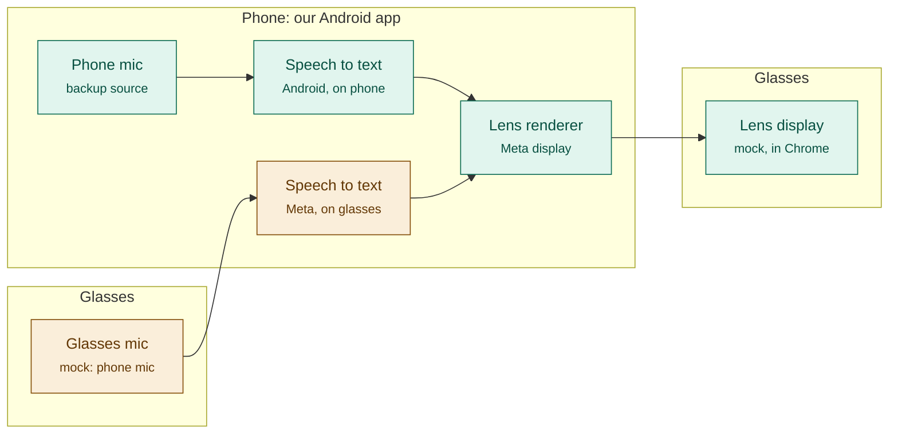
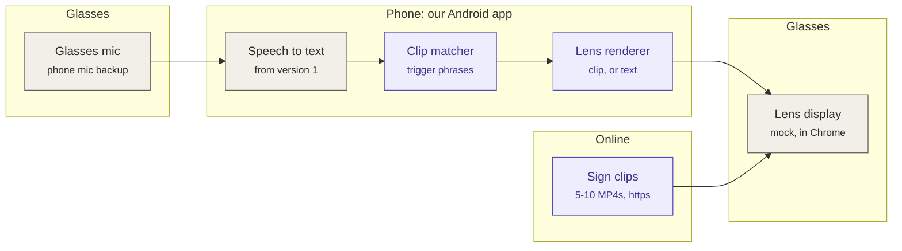
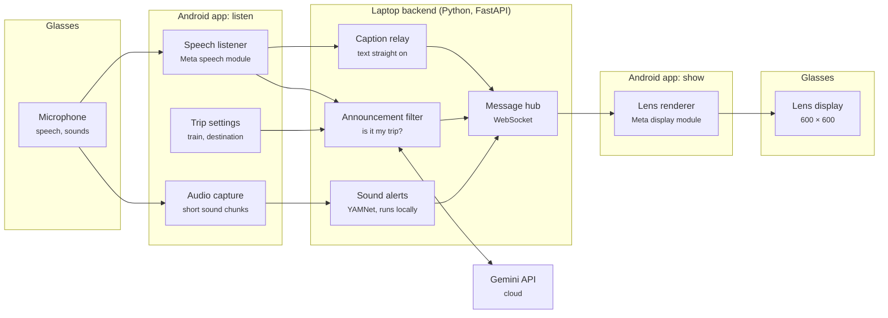
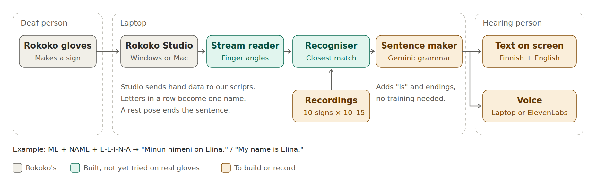
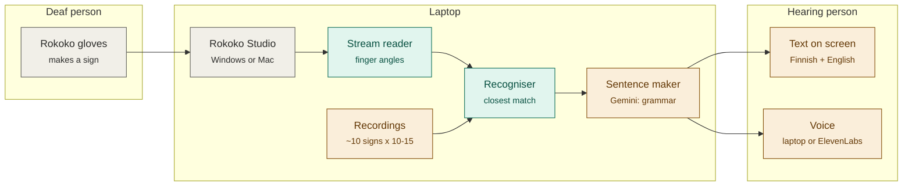

# Architecture

Smart glasses for deaf and hard-of-hearing people. The wearer keeps looking at the people around them while the glasses show:

1. **Captions** of what is being said.
2. **Announcements that matter**: only station announcements about the wearer's own trip.
3. **Danger alerts**: a clear warning for alarms, sirens and car horns.

Each diagram is shown as an image (works in Android Studio and on GitHub). The editable source is in `docs/images/*.svg`; a Mermaid version follows each image for GitHub.

## Version 1: listen and show (now and next)

Someone speaks and the words appear in the glasses lens. Everything runs inside the Android app. Green parts work today; amber is the step we are building now.

Mermaid source

**Done and working**
- **Phone mic and speech to text:** the phone's microphone and Android's built-in speech recognition turn speech into text as the person talks. Stays in the app as the backup.
- **Lens renderer:** Meta's display module (`mwdat-display`) draws the latest lines of text in the lens.
- **Lens display:** Meta's mock glasses (`mwdat-mockdevice`) act like a Ray-Ban Display, and their lens can be viewed in Chrome.

**Next: building now**
- **Glasses mic and speech to text on the glasses:** Meta's speech module (`mwdat-speech`, experimental) recognises speech on the glasses and sends the text to the app, which draws it in the lens. While the glasses are back with Meta, the mock glasses listen through the phone's microphone, but the text reaches the app along the same path the real glasses will use.
- **Switch:** a button in the app picks the glasses mic or the phone mic. Only one listens at a time.

Done means: you speak and the words appear in the mock lens within about a second, coming through the glasses speech path.

## Version 2: sign clips (after version 1 works)

Some deaf people find sign language easier than reading. For a small set of important messages the lens plays a short sign language clip instead of the caption text. Grey parts come from version 1; purple parts are new.

Mermaid source

- **Clip matcher:** checks each finished sentence for the trigger phrases of each clip, for example "fire alarm" or "evacuate" for the danger clip, "platform" or "track" for the platform-changed clip. Simple keyword matching; no model training. Gemini can take over later if announcements are worded in too many ways.
- **Lens renderer:** plays the matching clip in the glasses' full-screen video player, then goes back to captions. With no match it shows the caption text as in version 1.
- **Sign clips:** 5–10 short Finnish Sign Language videos recorded by a signer, hosted on an https address (for example GitHub Pages). Meta's limits: MP4 only, at most 400 pixels per side and 70,000 pixels in total (about 260 × 260), one video at a time. The glasses fetch the clip themselves.

Check first: does video play in the mock lens in Chrome?

## Full system

Mermaid source

| Part | What it does |
|---|---|
| Speech listener | Turns speech from the glasses' microphone into text. Fallback: the phone's microphone. |
| Trip settings | The wearer types their train and destination once. |
| Audio capture | Sends short sound clips to the backend for the danger alerts. Audio is never stored. |
| Caption relay | Sends speech text straight back to the lens as captions. |
| Announcement filter | Asks Gemini whether an announcement concerns the wearer's trip, and returns a short summary and its urgency. |
| Sound alerts | YAMNet, a pretrained sound classifier, recognises fire alarms, smoke detectors, sirens and car horns. |
| Message hub | Sends captions, announcement cards and alerts to the app as they happen. |
| Lens renderer | Draws them in the lens: alerts at the top, announcement cards in the middle, captions at the bottom. |

## Gloves: signs to text and voice (separate plan)

The glasses help the deaf person understand others. The gloves work the other way round: the deaf person signs, and a hearing person who does not know sign language reads or hears it, in Finnish and English. A separate team member works on this; it is not connected to the glasses app.

Mermaid source

- **Rokoko gloves and Studio:** the gloves measure finger bend and hand rotation. Rokoko Studio (Windows or Apple-silicon Mac only, not Linux) streams this to our scripts on the same laptop.
- **Stream reader and recogniser** (`gloves/`, built, not yet tried on real gloves): the recogniser compares the live hand with the recorded signs and picks the closest one, or none. No long training: adding a sign means recording it. Letters signed one after another are joined into one word, for example a fingerspelled name.
- **Recordings** (to do): about 10 signs plus a relaxed "rest" pose, 10–15 repetitions each, made with `gloves/record.py`. The demo signs are still to be chosen with our signer; for example ME, NAME, STUDY, OTANIEMI and only the letters a name needs.
- **Sentence maker** (to build): Finnish Sign Language has no word for "is" and no word endings, so the signs come out in base form. Holding the rest pose for about a second ends the sentence; the signs then go to Gemini with a short instruction and a few examples, and it writes the sentence in Finnish and English. No training needed. Examples:
  - ME + NAME + E-L-I-N-A → "Minun nimeni on Elina." / "My name is Elina."
  - ME + STUDY + OTANIEMI → "Minä opiskelen Otaniemessä." / "I study in Otaniemi."
- **Text on screen and voice** (to build): the raw signs and the sentence shown large on the laptop, so people can see if the AI guessed wrong, and the sentence spoken aloud (laptop's own voice first, ElevenLabs if there is time). Fixed answers for the demo sentences are the backup if the internet fails.

Limits:
- **Where the hand is:** the gloves measure finger bend and hand rotation, not where the hand is relative to the body. A sign like STUDY, which moves from the waist to the head, may still be told apart by how the hand turns. Test it early, and ask Rokoko whether the gloves can report hand position.
- **Sign length:** recordings are currently about half a second (30 frames). Long movements need about 1–1.5 seconds, so `record.py` and `recognise.py` must use a longer window.

Decision point: if the gloves are not streaming by Saturday 14:00, drop them from the demo and mention them in the pitch as future work.

## Privacy and safety

- Audio is processed as it arrives and is never stored.
- Only text goes to the cloud (Gemini), never sound.
- The lens shows when the app is listening.

## Out of scope

- **Live translation of any speech into sign language.** Sign languages have their own grammar, facial expressions and movement, so this cannot be done word by word, and no reliable system exists yet. Version 2 covers only a small set of important messages with 5–10 pre-recorded sign clips.
- **Full sign language interpretation.**
- **Meeting apps.** Captions for Google Meet, Teams, Zoom and similar calls are part of the long-term goal but are not built for the hackathon.
- **Connecting the gloves to the glasses.** The gloves run as a separate demo on the laptop (see above).
