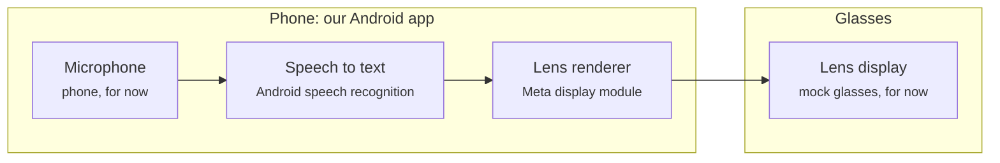
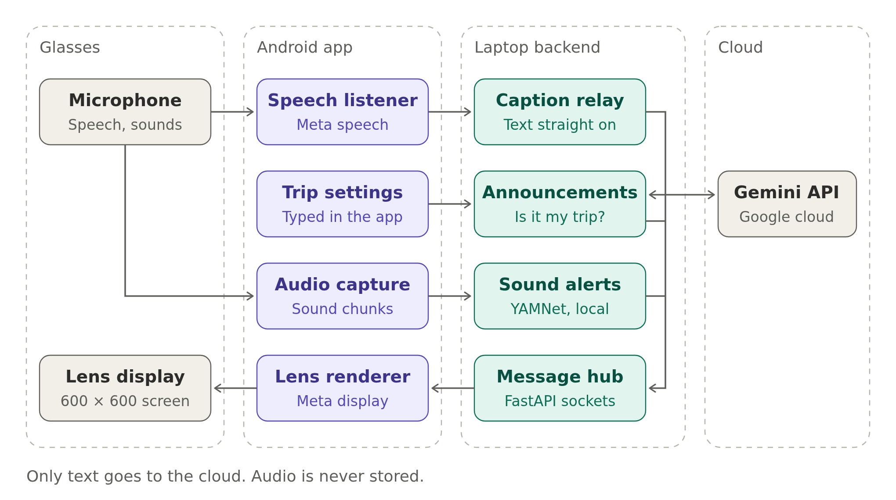
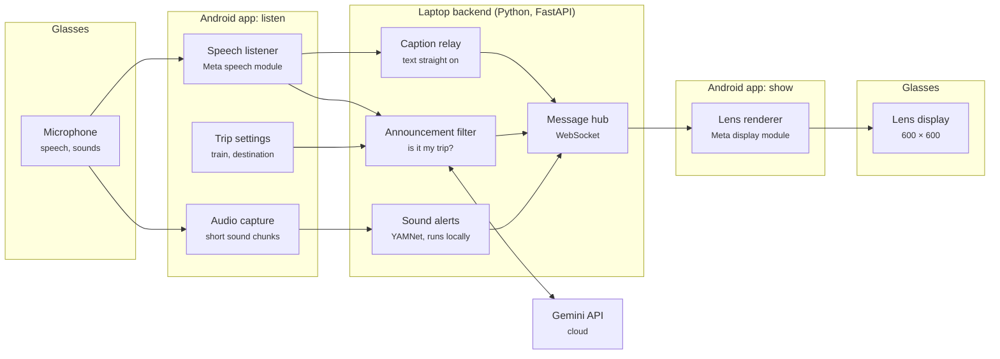

# Architecture

Smart glasses for deaf and hard-of-hearing people. The wearer keeps looking at the people around them while the glasses show:

1. **Captions** of what is being said.
2. **Announcements that matter**: only station announcements about the wearer's own trip.
3. **Danger alerts**: a clear warning for alarms, sirens and car horns.

Each diagram is shown as an image (works in Android Studio and on GitHub). The editable source is in `docs/images/*.svg`; a Mermaid version follows each image for GitHub.

## Version 1: listen and show

The first version does one thing: someone speaks near the phone and the words appear in the glasses lens. Everything runs inside the Android app.

Mermaid source

- **Microphone:** the phone's own microphone until we have the glasses again. Later the glasses' microphone replaces it.
- **Speech to text:** Android's built-in speech recognition turns speech into text as the person talks.
- **Lens renderer:** Meta's Device Access Toolkit display module (`mwdat-display`) draws the latest lines of text in the lens.
- **Lens display:** Meta's mock glasses (`mwdat-mockdevice`) act like a Ray-Ban Display, and their lens can be viewed in Chrome. Later the real Ray-Ban Display replaces them.

Done means: you speak near the phone and the words appear in the mock lens within about a second.

## Full system

Mermaid source

| Part | What it does |
|---|---|
| Speech listener | Turns speech from the glasses' microphone into text. Fallback: the phone's microphone. |
| Trip settings | The wearer types their train and destination once. |
| Audio capture | Sends short sound clips to the backend for the danger alerts. Audio is never stored. |
| Caption relay | Sends speech text straight back to the lens as captions. |
| Announcement filter | Asks Gemini whether an announcement concerns the wearer's trip, and returns a short summary and its urgency. |
| Sound alerts | YAMNet, a pretrained sound classifier, recognises fire alarms, smoke detectors, sirens and car horns. |
| Message hub | Sends captions, announcement cards and alerts to the app as they happen. |
| Lens renderer | Draws them in the lens: alerts at the top, announcement cards in the middle, captions at the bottom. |

## Privacy and safety

- Audio is processed as it arrives and is never stored.
- Only text goes to the cloud (Gemini), never sound.
- The lens shows when the app is listening.

## Out of scope

Speech to sign language, full sign language interpretation and integration with meeting apps. Captions for Google Meet, Teams, Zoom and similar calls are part of the long-term goal but are not built for the hackathon. Signing to voice (Rokoko gloves and ElevenLabs) is a stretch goal and not part of these diagrams yet.
