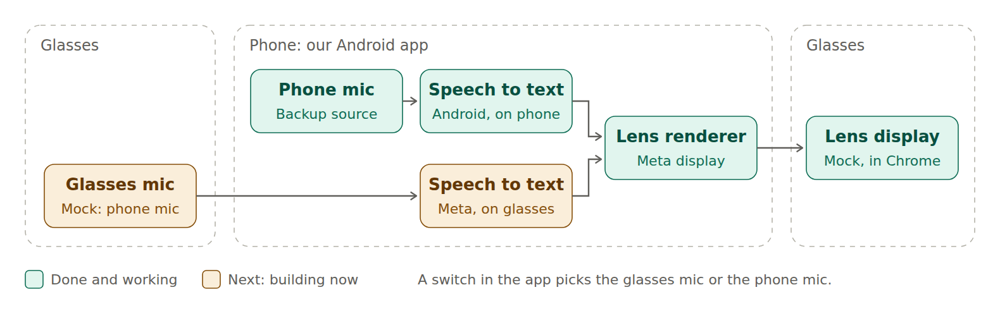
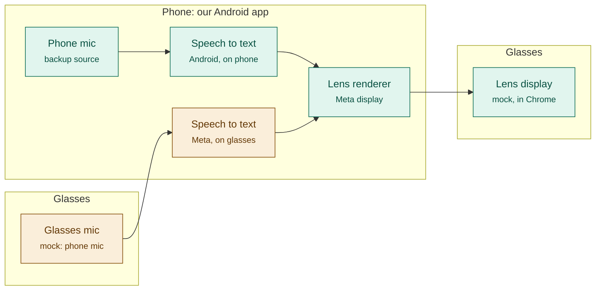
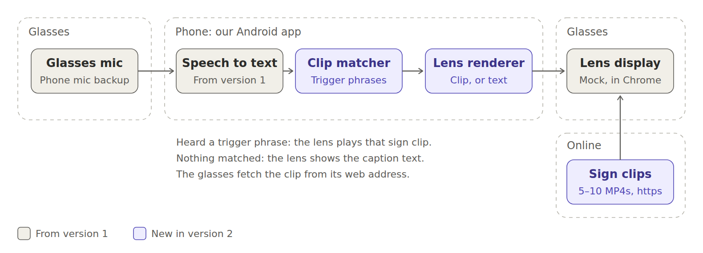
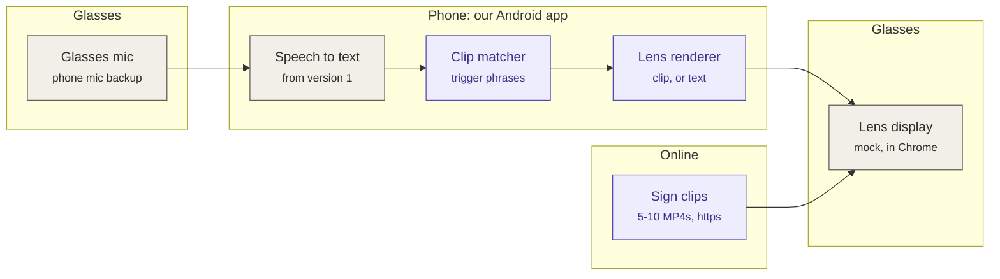
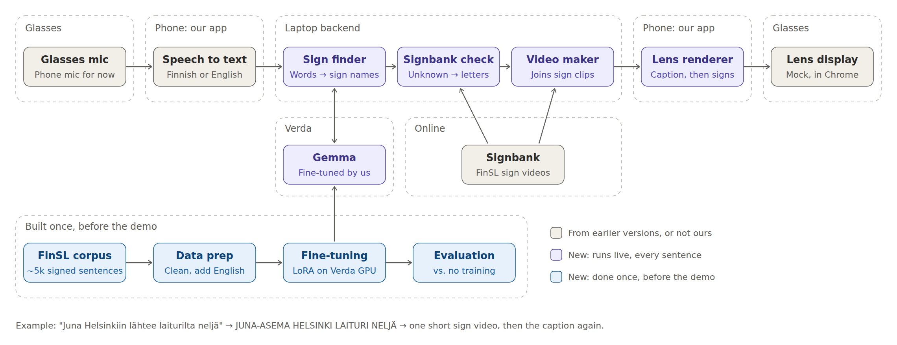
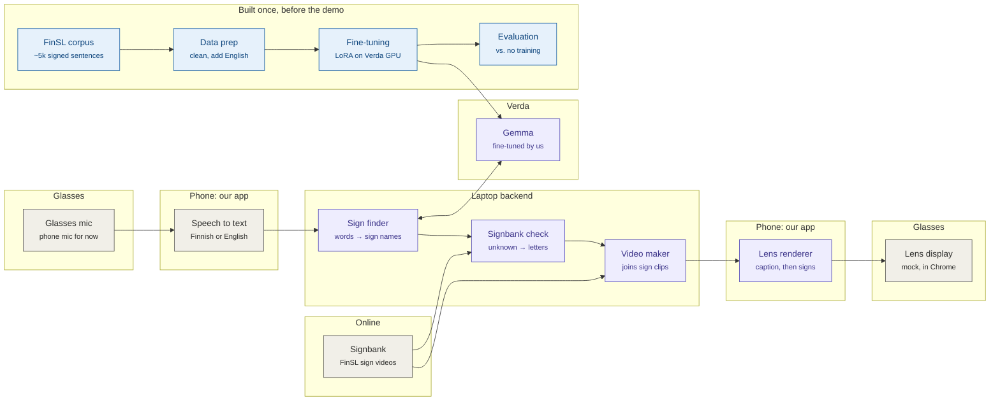
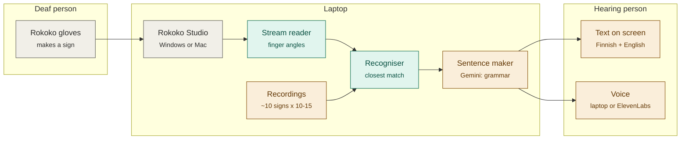

# Architecture

Two-way communication between deaf and hearing people. Communication always goes both ways, so the system has two halves:

- **Hearing person → deaf person (glasses):** the wearer keeps looking at the people around them while the glasses show:
    1. **Captions** of what is being said.
    2. **Announcements that matter**: only station announcements about the wearer's own trip.
    3. **Danger alerts**: a clear warning for alarms, sirens and car horns.
- **Deaf person → hearing person (gloves):** the deaf person signs, and the hearing person reads or hears it in Finnish or English.

Each diagram is shown as an image (works in Android Studio and on GitHub). The editable source is in `docs/images/*.svg`; a Mermaid version follows each image for GitHub.

## Version 1: listen and show (now and next)

Someone speaks and the words appear in the glasses lens. Everything runs inside the Android app. Green parts work today; amber is the step we are building now.

Mermaid source

**Done and working**

- **Phone mic and speech to text:** the phone's microphone and Android's built-in speech recognition turn speech into text as the person talks. Stays in the app as the backup.
- **Lens renderer:** Meta's display module (`mwdat-display`) draws the latest lines of text in the lens.
- **Lens display:** Meta's mock glasses (`mwdat-mockdevice`) act like a Ray-Ban Display, and their lens can be viewed in Chrome.

**Next: building now**

- **Glasses mic and speech to text on the glasses:** Meta's speech module (`mwdat-speech`, experimental) recognises speech on the glasses and sends the text to the app, which draws it in the lens. While the glasses are back with Meta, the mock glasses listen through the phone's microphone, but the text reaches the app along the same path the real glasses will use.
- **Switch:** a button in the app picks the glasses mic or the phone mic. Only one listens at a time.

Done means: you speak and the words appear in the mock lens within about a second, coming through the glasses speech path.

## Version 2: sign clips (after version 1 works)

Some deaf people find sign language easier than reading. For a small set of important messages the lens plays a short sign language clip instead of the caption text. Grey parts come from version 1; purple parts are new.

Mermaid source

- **Clip matcher:** checks each finished sentence for the trigger phrases of each clip, for example "fire alarm" or "evacuate" for the danger clip, "platform" or "track" for the platform-changed clip. Simple keyword matching; no model training. Gemini can take over later if announcements are worded in too many ways.
- **Lens renderer:** plays the matching clip in the glasses' full-screen video player, then goes back to captions. With no match it shows the caption text as in version 1.
- **Sign clips:** 5–10 short Finnish Sign Language videos recorded by a signer, hosted on an https address (for example GitHub Pages). Meta's limits: MP4 only, at most 400 pixels per side and 70,000 pixels in total (about 260 × 260), one video at a time. The glasses fetch the clip themselves.

Check first: does video play in the mock lens in Chrome?

## Version 3: FinSL signs for any sentence (decided Saturday)

Version 2 only covers a handful of fixed messages. Version 3 shows Finnish Sign Language (FinSL) signs for **any** sentence someone says, in **Finnish or English**. We teach a small AI model (Gemma) the order signs come in, using real FinSL data. The caption text stays; the signs play after each sentence as a short video, then the caption comes back. Grey parts come from earlier versions or from others; purple runs live for every sentence; blue is done once, before the demo. Full design: `docs/superpowers/specs/2026-11-14-finsl-signs-design.md`.

Mermaid source

**What happens for every sentence (purple):**

- **Sign finder:** when a sentence is finished, the phone sends it to the laptop. The laptop asks our Gemma model, running on Verda, which signs to show and in which order. Example: *"Juna Helsinkiin lähtee laiturilta neljä"* → `JUNA-ASEMA HELSINKI LAITURI NELJÄ`. Sign language has its own word order and leaves out words like "is", which is why a model is used instead of swapping word for word. If Gemma does not answer within about 3 seconds, Gemini does the same job as a backup.
- **Signbank check:** every sign name is looked up in Finnish Signbank, the official FinSL dictionary. Only signs that really exist are shown. A word with no sign (a name, for example) is spelled with the finger alphabet. This is how we make sure nobody is shown a made-up sign.
- **Video maker:** joins the Signbank video of each sign into one short clip and makes it small enough for the lens (Meta's limit is 400 pixels per side).
- **Lens renderer:** shows the caption, plays the sign clip full screen, then shows the caption again. A "Signs" switch in the app turns this off; with it off, or with the laptop unreachable, captions work exactly as before.

**What we do once, before the demo (blue):**

- **FinSL corpus:** real recordings of 21+ deaf signers retelling cartoons and picture books, from the University of Jyväskylä. Each sentence comes with its signs written down in order and a Finnish translation: about 5,000 examples. Downloaded to `../finsl-data/` (outside this repo; see `LINKS.md` there).
- **Data prep:** remove notes like "pointing" or "unclear", have Gemini translate each Finnish sentence to English (same signs), and add a few dozen station-announcement examples written by us, since the recordings are stories, not stations.
- **Fine-tuning:** teach a small Gemma model on a rented Verda GPU, from sentence to signs. A laptop cannot do this in the time we have.
- **Evaluation:** test on signers the model never saw, comparing our trained model with an untrained one, so we can show a real number in the pitch.

**Limits to say out loud:**

- This is not sign language interpretation: signs in sign order, without the facial expressions and use of space that real FinSL grammar needs.
- The recordings are stories, so the model knows "man", "sit" and "run" better than "platform" or "delayed".
- A sign video takes 1–3 seconds per sign, much slower than speech. If people keep talking, older sentences are skipped so the lens never falls behind.
- The corpus and the Signbank videos may only be used non-commercially (CC BY-NC-SA) and with credit, so they stay out of this MIT-licensed repo. The corpus shows real people, so we publish a short privacy notice and delete it after the event.

## Gloves: signs to text and voice

The other half of the conversation. The glasses help the deaf person understand others; the gloves let the deaf person answer: they sign, and a hearing person who does not know sign language reads or hears it, in Finnish and English.

Mermaid source

- **Rokoko gloves and Studio:** the gloves measure finger bend and hand rotation. Rokoko Studio (Windows or Apple-silicon Mac only, not Linux) streams this to our scripts on the same laptop.
- **Stream reader and recogniser** (`gloves/`, built, not yet tried on real gloves): the recogniser compares the live hand with the recorded signs and picks the closest one, or none. No long training: adding a sign means recording it. Letters signed one after another are joined into one word, for example a fingerspelled name.
- **Recordings** (to do): about 10 signs plus a relaxed "rest" pose, 10–15 repetitions each, made with `gloves/record.py`. The demo signs are still to be chosen with our signer; for example ME, NAME, STUDY, OTANIEMI and only the letters a name needs.
- **Sentence maker** (to build): Finnish Sign Language has no word for "is" and no word endings, so the signs come out in base form. Holding the rest pose for about a second ends the sentence; the signs then go to Gemini with a short instruction and a few examples, and it writes the sentence in Finnish and English. No training needed. Examples:
    - ME + NAME + E-L-I-N-A → "Minun nimeni on Elina." / "My name is Elina."
    - ME + STUDY + OTANIEMI → "Minä opiskelen Otaniemessä." / "I study in Otaniemi."
- **Text on screen and voice** (to build): the raw signs and the sentence shown large on the laptop, so people can see if the AI guessed wrong, and the sentence spoken aloud (laptop's own voice first, ElevenLabs if there is time). Fixed answers for the demo sentences are the backup if the internet fails.

Limits:

- **Where the hand is:** the gloves measure finger bend and hand rotation, not where the hand is relative to the body. A sign like STUDY, which moves from the waist to the head, may still be told apart by how the hand turns. Test it early, and ask Rokoko whether the gloves can report hand position.
- **Sign length:** recordings are currently about half a second (30 frames). Long movements need about 1–1.5 seconds, so `record.py` and `recognise.py` must use a longer window.

## Privacy and safety

- Audio is processed as it arrives and is never stored.
- Only text goes to the cloud (Gemini), never sound.
- The lens shows when the app is listening.

## Out of scope

- **Real sign language interpretation of speech.** Sign languages have their own grammar, facial expressions and movement, and no reliable system exists yet. Version 3 shows FinSL signs in sign order for any sentence, which helps but is not interpretation, and the pitch says so.
- **Full sign language interpretation.**
- **Meeting apps.** Captions for Google Meet, Teams, Zoom and similar calls are part of the long-term goal but are not built for the hackathon.
- **One shared device for both halves.** This weekend the glasses half runs on the phone and the gloves half on a laptop; they work side by side in the same conversation but do not exchange data.
